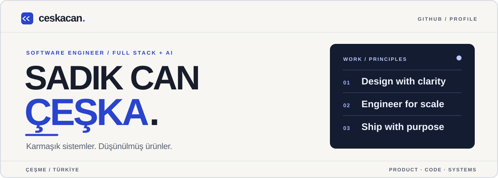

  

   

  <a href="https://ceskacan.com/">Portföy</a>
  &nbsp;·&nbsp;
  <a href="https://ceskacan.com/en.html">English</a>
  &nbsp;·&nbsp;
  <a href="https://www.linkedin.com/in/ceskacan">LinkedIn</a>
  &nbsp;·&nbsp;
  <a href="mailto:sadktyk@gmail.com">İletişim</a>
  &nbsp;·&nbsp;
  <a href="https://ceskacan.com/cv-tr.pdf">CV / PDF</a>

 

### Merhaba, ben Can.

Çeşme'de yaşayan bir **yazılım mühendisiyim.** Full stack ürün geliştirme, uygulamalı yapay zekâ ve sistem tasarımı üzerinde çalışıyorum.

Bir ürünün arayüzünün nasıl hissettirdiğini ve arkasındaki sistemin nasıl çalıştığını aynı tasarım probleminin iki tarafı olarak görüyorum. Önceliğim; **anlaşılır mimari, düşünülmüş etkileşim, erişilebilirlik ve performans.**

<code>Full stack</code> &nbsp; <code>Applied AI / NLP</code> &nbsp; <code>Product engineering</code> &nbsp; <code>System design</code>

---

### 01 / Seçilmiş çalışmalar

**01 — [AppAnvil](https://ceskasc.github.io/appanvil/)**  
179 uygulamayı tek katalogda toplayan, masaüstünde kurulum betiği ve mobilde resmî mağaza yönlendirmeleri sunan uygulama seçici.  
[Canlı ürün](https://ceskasc.github.io/appanvil/) · [Mühendislik incelemesi](https://ceskacan.com/projects/appanvil.html)

**02 — [CV Studio](https://ceskasc.github.io/cvstudio/)**  
Sekiz farklı tema, canlı önizleme, cihazda taslak kaydı ve PDF dışa aktarma ile sade bir CV hazırlama deneyimi.  
[Canlı ürün](https://ceskasc.github.io/cvstudio/) · [Mühendislik incelemesi](https://ceskacan.com/projects/cvstudio.html)

**03 — [NoirWave](https://ceskasc.github.io/NoirWave/)**  
Müzik arşivi ve canlı radyoyu tek oynatıcıda buluşturan, etkileşimi ve durum yönetimini öne alan müzik deneyimi.  
[Canlı ürün](https://ceskasc.github.io/NoirWave/) · [Mühendislik incelemesi](https://ceskacan.com/projects/noir.html)

**04 — [Lunara](https://ceskacan.com/projects/lunara.html)**  
Oyuncu hesapları, ilerleme ve gerçek zamanlı rekabet için tasarlanmış oyun platformu mimarisi.  
[Mühendislik incelemesi](https://ceskacan.com/projects/lunara.html)

**05 — [Architect Portfolio](https://ceskasc.github.io/architect-portfolio/)**  
Mimari projeleri ve hikâyelerini öne çıkaran; hafif, duyarlı ve içerik odaklı portföy.  
[Canlı ürün](https://ceskasc.github.io/architect-portfolio/) · [Mühendislik incelemesi](https://ceskacan.com/projects/architect.html)

**06 — [QR Studio](https://ceskasc.github.io/qr-generator/)**  
Logolu QR kod, tarama ve doğrulama, toplu üretim ve farklı biçimlerde dışa aktarma araçları.  
[Canlı ürün](https://ceskasc.github.io/qr-generator/) · [Mühendislik incelemesi](https://ceskacan.com/projects/qr.html)

---

### 02 / Çalışma alanım

**Arayüz ve ürün** — TypeScript, JavaScript, React, Next.js, HTML, CSS  
**Servisler ve veri** — Node.js, C#, .NET, PostgreSQL, REST, gerçek zamanlı akışlar  
**Uygulamalı yapay zekâ** — Python, makine öğrenmesi, doğal dil işleme  
**Geliştirme ve teslimat** — Git, GitHub Actions, test, performans ve erişilebilirlik

Sadece teknoloji seçimini değil; kararların gerekçesini, sınırlarını ve ürün üzerindeki etkisini de göstermeyi önemsiyorum. Bunun için portföyümde [etkileşimli bir mühendislik laboratuvarı](https://ceskacan.com/lab.html) ve [proje incelemeleri](https://ceskacan.com/#work) bulunuyor.

### 03 / Deneyim

**NEO GROUP** · Yazılım mühendisliği — güncel  
**Yandex** · Makine öğrenmesi ve .NET geliştirme  
**A.S.A.M.** · Yazılım ve teknoloji

Ayrıntılı çalışma geçmişi, seçili projeler ve özgeçmiş için **[portföyüme göz at](https://ceskacan.com/overview.html).**

  
<strong>English / About me</strong>

   
  I'm Can, a software engineer based in Çeşme, Türkiye. I build full-stack digital products and work with applied AI, NLP and system design. I care about clear architecture, thoughtful interfaces, accessibility and measurable performance.

  Explore my <a href="https://ceskacan.com/en.html">English portfolio</a> or <a href="https://ceskacan.com/resume-en.pdf">download my résumé</a>.

 

---

  Design with clarity. Engineer with intent. Build what matters.
   
  <a href="https://ceskacan.com/">ceskacan.com</a> · <a href="https://github.com/ceskasc">github.com/ceskasc</a>

