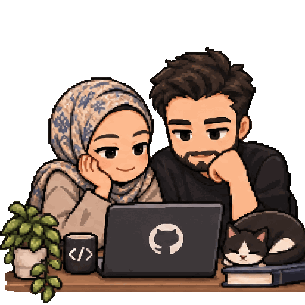

  

  

    <a href="https://ceskacan.com/"><strong>Portföy</strong></a>
    &nbsp;·&nbsp;
    <a href="https://ceskacan.com/en.html">English</a>
    &nbsp;·&nbsp;
    <a href="https://www.linkedin.com/in/ceskacan">LinkedIn</a>
    &nbsp;·&nbsp;
    <a href="https://ceskacan.com/cv-tr.pdf">Özgeçmiş</a>
    &nbsp;·&nbsp;
    <a href="mailto:sadktyk@gmail.com">İletişim</a>
  

  

  
Biraz kod, biraz hayat. Özenle tasarlanmış küçük bir dünya.

 

### 01 / Merhaba, ben Can.

Çeşme'de yaşayan bir **yazılım mühendisiyim.** Full stack ürünler, uygulamalı yapay zekâ ve kullanıcı odaklı dijital deneyimler geliştiriyorum.

İyi bir ürünün sadece çalışması yeterli değil: **anlaşılır, hızlı, erişilebilir ve kullanırken doğal hissettiren** bir bütün olması gerektiğine inanıyorum. Arayüz, mimari ve veri katmanını bu nedenle bir arada düşünüyorum.

**Odak alanlarım** &nbsp; `Full Stack` · `Product Engineering` · `Applied AI / NLP` · `System Design`

---

### 02 / Seçilmiş projeler

FİKİRDEN ÇALIŞAN ÜRÜNE

#### 01 — [AppAnvil](https://ceskasc.github.io/appanvil/)

**Uygulama keşfi ve kurulumu.** 179 uygulamalık katalog; masaüstünde kurulum betiği, mobilde resmî mağaza bağlantıları.

[Canlı projeyi aç ↗](https://ceskasc.github.io/appanvil/) &nbsp;·&nbsp; [Teknik inceleme](https://ceskacan.com/projects/appanvil.html)

#### 02 — [CV Studio](https://ceskasc.github.io/cvstudio/)

**Kişisel CV hazırlama stüdyosu.** Sekiz tema, anlık önizleme, cihazda taslak kaydı ve PDF dışa aktarma.

[Canlı projeyi aç ↗](https://ceskasc.github.io/cvstudio/) &nbsp;·&nbsp; [Teknik inceleme](https://ceskacan.com/projects/cvstudio.html)

#### 03 — [NoirWave](https://ceskasc.github.io/NoirWave/)

**Müzik ve canlı radyo, tek arayüzde.** Oynatma deneyimi, yerel müzik arşivi ve gerçek zamanlı durum yönetimine odaklanan müzik ürünü.

[Canlı projeyi aç ↗](https://ceskasc.github.io/NoirWave/) &nbsp;·&nbsp; [Teknik inceleme](https://ceskacan.com/projects/noir.html)

#### 04 — [QR Studio](https://ceskasc.github.io/qr-generator/)

**QR üretimi ve tasarımı.** Logo ekleme, tarama, doğrulama, toplu üretim ve PNG / SVG / PDF çıktıları.

[Canlı projeyi aç ↗](https://ceskasc.github.io/qr-generator/) &nbsp;·&nbsp; [Teknik inceleme](https://ceskacan.com/projects/qr.html)

#### 05 — [Architect Portfolio](https://ceskasc.github.io/architect-portfolio/)

**Hikâye anlatan bir portföy.** Mimari projeleri öne çıkaran, sade tasarımlı, mobil uyumlu ve hafif web deneyimi.

[Canlı projeyi aç ↗](https://ceskasc.github.io/architect-portfolio/) &nbsp;·&nbsp; [Teknik inceleme](https://ceskacan.com/projects/architect.html)

#### 06 — [Lunara](https://ceskacan.com/projects/lunara.html)

**Gerçek zamanlı oyun platformu.** Oyuncu kimlikleri, ilerleme ve canlı rekabet için sistem tasarımı.

[Teknik incelemeyi oku ↗](https://ceskacan.com/projects/lunara.html)

<a href="https://ceskacan.com/#work">Tüm çalışmaları portföyümde incele ↗</a>

---

### 03 / Kullandığım teknolojiler

**Frontend & deneyim**  
`TypeScript` · `JavaScript` · `React` · `Next.js` · `HTML` · `CSS`

**Backend & veri**  
`Node.js` · `C#` · `.NET` · `PostgreSQL` · `SQL` · `REST APIs`

**AI & mühendislik**  
`Python` · `Machine Learning` · `NLP` · `Git` · `GitHub Actions`

Benim için teknoloji, sonuca ulaşmanın aracı. Asıl önem verdiğim şey; **doğru problem tanımı, ölçülebilir performans ve bakımı kolay sistemler.**

---

### 04 / Deneyim ve yaklaşım

- **NEO GROUP** — Yazılım mühendisliği · Güncel
- **Yandex** — Makine öğrenmesi ve .NET geliştirme
- **A.S.A.M.** — Yazılım ve teknoloji

Projelerin arkasındaki kararları yalnızca anlatmak yerine göstermeyi seviyorum. Portföyümde bunun için [çalışan bir NLP laboratuvarı](https://ceskacan.com/lab.html), [proje vaka analizleri](https://ceskacan.com/#work) ve [profesyonel özetim](https://ceskacan.com/overview.html) bulunuyor.

<strong>English · A little about me</strong>

 

I'm **Can**, a software engineer based in Çeşme, Türkiye. I build full-stack digital products, work with applied AI and NLP, and care deeply about thoughtful interfaces, system clarity, accessibility and performance.

My projects cover product engineering, developer tools, music experiences, and realtime systems.

[Explore my English portfolio →](https://ceskacan.com/en.html) · [Résumé (PDF)](https://ceskacan.com/resume-en.pdf)

 

---

<strong>DESIGN WITH CLARITY. ENGINEER WITH INTENT.</strong>

© Sadık Can Çeşka · <a href="https://ceskacan.com/">ceskacan.com</a> · <a href="https://github.com/ceskasc">GitHub</a>

